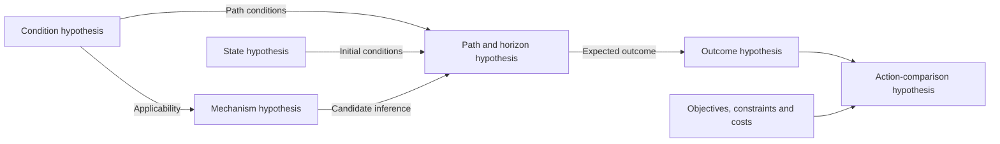

Many judgements in research and decision-making require continuing updates from evidence. More material does not automatically mean more reliable understanding.

This article proposes a reviewable method: **distinguish hypotheses and their dependencies, locate evidence by object, variable and timescale, and examine the conditions through which it affects other judgements.** Stronger support, weaker support, no change and inability to judge all need reasons.

The main text presents a hypothesis dependency graph, twelve review questions, transmission and revision rules, record templates and an abstract conditional analysis. The complete method still needs independent testing. It supports research review and does not directly generate operational instructions; investment uses do not constitute investment or trading advice.

## 1. Begin with a hypothesis dependency graph

An overall judgement often contains several distinct hypotheses:

| Type | What needs specifying? |
|---|---|
| Outcome hypothesis | The observable result expected under specified conditions and over a stated horizon |
| Mechanism hypothesis | How variables produce change through relationships, and which competing explanations remain |
| Condition hypothesis | Whether a condition is necessary, sufficient, facilitating or inhibiting, and on what basis |
| State hypothesis | Current values or states of relevant variables, with measurement and estimation uncertainty |
| Path and horizon hypothesis | Intermediate processes and deadlines through which an outcome may be reached |
| Action-comparison hypothesis | How candidate actions and temporary inaction compare under specified objectives, constraints and costs |

These are optional dimensions of decomposition, not a compulsory hierarchy. A condition may affect several hypotheses, and several mechanisms may explain an outcome. A dependency graph is therefore more suitable than forcing every relationship into a single-path tree.

This illustrates dependencies. Arrows do not establish the relationships, and an observed outcome does not confirm its upstream mechanism. Where feedback matters, distinguish nodes at different times rather than turning same-time mutual support into circular proof.

Give each node a stable identifier, content, conditions, horizon and version. Record the type, basis and unknowns of each dependency. **One item may update several nodes, but each propagation requires an explained path.** Observations with a common source or shock do not become independent confirmations because they are attached to different nodes.

Evaluation standards should be symmetric. Supporting and opposing items need not be equal in number; material of different quality, relevance and independence should still receive different weights.

## 2. Twelve questions for each evidence update

### Gathering: what has not entered the research file?

**1. Which hypothesis is being tested now?** Identify the hypothesis node, version and direct dependencies; state the object, target variables, evaluation horizon and information cut-off. Identify relevant fast and slow processes, the basis for classification and unknowns. Retain at least one explanatory competing hypothesis.

**2. Does the search presuppose a favourable answer?** Record the search scope, terms, sources and stopping conditions. Check whether the search asks only why something will succeed without also seeking facts that would weaken the hypothesis. Differences in search terms are review signals, not proof of bias.

**3. Is there a record of the search for competing explanations?** Preserve what was examined, what was found and what remains missing. “No disconfirming evidence found” needs a search scope; it cannot simply become “no disconfirming evidence exists”.

### Evaluation: are the same standards being applied?

**4. Are favourable and unfavourable reports evaluated by the same criteria?** Give reasons concerning source, timeliness, definitions, verifiability and relevance. In particular, check whether favourable statements are accepted as delivery while adverse material faces a higher evidential threshold.

**5. Are several messages actually one piece of evidence?** Retain original sources and dependency relationships. Reposts, common data sources and several indicators driven by one underlying factor do not automatically provide independent confirmations.

**6. Which variable does the information concern, and does it distinguish competing explanations?** Identify a direct observation, proxy or source claim, then compare transient-state, persistent-change and mechanism-change explanations. An output compatible with several mechanisms does not confirm one of them on its own; seek observations for which their expectations differ.

### Updating: what has actually changed?

**7. Does judgement of the same hypothesis change solely with one’s position or interests?** Hold the object, information, conditions and horizon fixed. Preferences and constraints can legitimately affect action, but cannot substitute for factual assessment. Changed objectives, tolerable costs or constraints may alter an action comparison; record this separately from support for the same factual hypothesis.

**8. What exactly does the new material update?** Separately record material quality, state or parameter estimates, actual changes, mechanism assessments and forecasts at different horizons. No change may be justified, but an unchanged long-term view does not answer a near-term constraint; short-lived news is not exempt from examination of structural consequences.

**9. Have the deadline, criterion or hypothesis been changed retrospectively?** New facts can justify changes. Retain the old version and explain the revision. A repeatedly extended deadline does not mean the original forecast has remained supported; nor should retrospective fast–slow reclassification exclude equally credible contrary material.

### Review: do records constrain memory and narrative?

**10. Is the review based on original records or recollection?** Compare information available at the time, forecasts, deadlines and subsequent outcomes. Retain successes, failures and unknowns. A favourable outcome and a correct explanation need separate assessment.

**11. Is an outcome from one system, level or horizon being treated as proof about another?** Record direct revisions separately from those transmitted through dependencies. Outcomes may offer clues but cannot establish an upstream mechanism by skipping intermediate conditions; shared support across nodes is not independently additive.

**12. Does the AI task presuppose that the original view must be proved?** Check whether AI is asked to provide only supporting reasons or to manufacture opposing material. The review should compare the original hypothesis and competitors under consistent quality standards and allow insufficient information as an outcome.

These questions identify points worth re-examining. Ticking boxes or completing a table does not certify the elimination of bias and should not be converted into a decision score without calibration.

## 3. Which variables does the evidence concern, and on what timescales?

### Separate revised knowledge, actual state changes and revised relationships

Evidence begins with observations and records. **Obtaining new evidence does not mean the system has just changed.** A record obtained today may reveal a longstanding condition; an actual shock may also generate a new observation. If disclosure itself changes expectations, behaviour or access to resources, that feedback needs separate modelling.

| Object of revision | Question to answer | What does not follow directly? |
|---|---|---|
| Estimate of an existing state or parameter | Was the condition unknown, poorly measured, or misestimated? | Learning about it today does not mean it began today |
| Actual system state | Which variable changed, when, and under which conditions? | An output change alone does not identify its cause or duration |
| Relationships or constraints | Do the mechanism, transmission paths or applicability conditions need revision? | A surprising result alone does not establish structural change |

These may occur together, or remain indistinguishable with available evidence. Retain competing explanations rather than treating every adverse result as structural failure, or making only local estimation adjustments to preserve a mechanism whose conditions no longer hold.

### Speed concerns the process being studied, not the appearance of the news

Record at least four different times: **when the event occurred, when the material became available, the relevant variable's change or recovery time, and the hypothesis's evaluation horizon.** Publication or measurement frequency does not, by itself, identify a fast or slow underlying process.

The comparisons below are conditional, not fixed classifications:

| Record and its object | How to assess relative speed | Implication for a hypothesis |
|---|---|---|
| An observation departing from its previous range | Potentially fast relative to capability development; check the observation horizon and previous variation | May update the current state; one fluctuation is generally insufficient on its own to identify long-term capability, but may justify further investigation |
| Comparable processes and outcomes across periods | May concern slower changes in capability accumulation, resource stocks or relationship stability | Check persistence against common cycles, measurement changes and shared sources; recurrence is not independent confirmation |
| A suddenly disclosed historical problem | The news arrives quickly; the condition may be longstanding | Can substantially revise estimates of slow variables or mechanisms; a one-day announcement is not a reason to dismiss it |
| A short shock and its propagation | The shock is fast but may alter later constraints through thresholds, accumulation or feedback | Examine absorption, recovery and future paths, rather than duration alone |

Slow variables are not automatically predictable; fast variables are not automatically brief, irrelevant or zero-mean. The same process may play different roles under different targets and horizons. If evidence does not support timescale separation, record it as undetermined rather than forcing a binary classification. Structural change need not be slow, and state change need not be fast.

### Fast–slow coupling: does a local change alter later paths?

An output deviation may be absorbed by the existing structure, reveal a slowly accumulated problem, or change another constraint through feedback. Trace the intermediate steps: **local change → affected channel or margin → recovery conditions → feasible paths within the target horizon.**

Persistence, propagation, synchronised changes and recovery times are possible clues to investigate, not sufficient proof of a structural transition. Conversely, a verified event that has already changed a necessary condition should not always be left pending for several more cycles.

Evidence assessment therefore retains at least four distinct dimensions: **its object, the relevant timescale, the reliability of the material, and its consequences for the current hypothesis.** A claim about a slow variable may be unreliable; a reliable fast-variable observation may directly concern an immediate constraint.

### Updates may differ across horizons without preserving a conclusion by changing its terms

The same material may change a near-term forecast without yet justifying revision of long-term capability, or change a long-term mechanism assessment without determining the next period's outcome. Record these updates separately. An unchanged long-term judgement does not resolve near-term constraints; improved long-term structure does not imply a favourable short-term outcome.

For signals requiring continued observation, specify expected persistence, discriminating observations and review deadlines in advance. Verified changes to necessary conditions call for reassessing affected hypotheses. **Do not label favourable fluctuations structural improvements while dismissing equally credible adverse fluctuations as short-term noise, or use a slow-variable account to postpone an original deadline indefinitely.**

## 4. Trace conditional transmission and distinguish mechanism review from replacement

### Retain intermediate links

The node directly supported by an observation differs from the other nodes it may affect through dependencies. For each path, ask:

- What are the intermediate links? Is each a definition, logical dependency, statistical association or causal mechanism awaiting examination?
- Which conditions have support, and which remain provisional assumptions? Unverified conditions should not be recorded as established.
- Where could transmission be blocked? Could delays, thresholds, feedback or recovery alter the effect?
- Are alternative paths available? If the outcome is absent, can channel failure be distinguished from an incomplete delay or missed observation?

A missing necessary condition may invalidate one path without excluding others. A facilitating condition does not make the outcome inevitable. Retain branches and unknowns where evidence is insufficient rather than treating a whole transmission chain as one confirmed fact.

### Anomalies can trigger review; accepting an alternative requires further support

The following are signals worth investigating, not a closed admission checklist: a declared necessary condition changes; outcomes repeatedly depart from expectations under comparable conditions; a competitor offers discriminating predictions; a path or constraint verifiably changes; or measurement definitions, omitted variables or applicability are called into question.

Separate three steps:

1. **Begin investigation.** Examine records, measurement, initial states, parameters, applicability and omissions. A single anomaly can justify investigation.
2. **Compare explanations again.** Identify observations that strengthen or weaken each mechanism and those that do not distinguish them. Do not preserve a mechanism through local estimation adjustments alone, or treat surprise as proof of a replacement.
3. **Accept a revised version.** State which relationships, scope conditions and predictions change, and why. Retain the earlier version. Insufficient evidence may leave several candidates or warrant suspending judgement.

**Failure to satisfy a mechanism's applicability conditions differs from refuting that mechanism within its declared scope.** A setback for the original explanation likewise does not establish an arbitrary alternative.

## 5. When should evidential relevance be reassessed?

Separate whether an older record is true, which current hypothesis it supports, and whether the relevant conditions still hold. Evidence does not uniformly expire with age or decay at a fixed rate.

| Change | What needs review? |
|---|---|
| System state or environment changes | Whether historical observations still represent the current state and the relationship remains applicable |
| Objective, deadline or hypothesis changes | Whether the evidence answers the same question or transfers to the new horizon |
| Measurement definitions, sources or common dependencies change | Whether records remain comparable and previous independence assessments hold |
| An expected observation does not appear | Whether coverage, elapsed time and the stated expectation of observing it justify updating from absence |

For each consequential item, state conditions for continued relevance, changes that could weaken relevance, the next review date and triggers for earlier review. A review date schedules a check; it does not make the record false automatically.

Recurrence adds information only to the extent that it adds discriminating content, measurement or coverage. Repeated reporting of the same fact does not accumulate independent support. A verified change to a critical condition should not wait for a scheduled review before affecting judgement.

## 6. Preserve dependencies and updates as records

### Hypothesis-node card: retain the initial version

| Field | Record |
|---|---|
| Node identifier and version | Hypothesis, object, target quantity, conditions, evaluation horizon and original record date |
| Upstream and downstream dependencies | Nodes directly depended on and affected; edge types, bases and unknowns |
| Variables, relationships and scales | Direct observations or proxies; relevant fast and slow processes, classification basis and coupling paths |
| Competing explanations and discriminating observations | Different expectations, useful discriminating observations and assessment criteria |
| Review and revision conditions | Scheduled review and absences, counterexamples or applicability changes requiring earlier investigation |
| Current support | Reasons, unknowns and sources; no falsely precise probabilities without calibration |

### Evidence card: preserve each consequential item

| Field | Record |
|---|---|
| Original record, type and source | Fact, source claim, inference, hypothesis or unknown; original source and shared dependencies |
| Times and definitions | Event and availability times; actual acquisition time and measurement definitions where needed |
| Directly addressed nodes and objects | Hypothesis, variable or relationship; direct observation, proxy or other evidence |
| Transmission and blocking points | Intermediate relationships, conditions, delays, feedback, blocks and alternatives needed to affect other nodes |
| Revision level and reasons | Revised estimate, confirmed actual change or mechanism review; affected horizons and reasons for unchanged judgements |
| Continued relevance and review | Conditions sustaining relevance, triggers for weaker relevance or earlier reassessment, and the next check |

### Update log: append rather than overwrite

| Date and evidence identifier | Affected nodes and versions | Judgement before and after, with reasons | Transmission conditions and unknowns | Next check |
|---|---|---|---|---|
| To record | To record | Strengthens, weakens, unchanged or cannot determine | To record | To record |

Also retain search scope, stopping conditions and consequential exclusion decisions. Propagate updates along supported dependencies; mark effects conditional where transmission remains unverified. A historical record may remain true while being marked as no longer representative of the current state.

## 7. An abstract conditional analysis

Suppose a candidate mechanism proposes that, under a set of conditions and within a declared initial-state range, a system follows a path to an outcome over a specified horizon. A competing explanation also accounts for part of the existing record. The rows below are separate possible situations, not a narrative of one event.

| New record | Direct update | Conditions for further updating |
|---|---|---|
| A measurement of the initial state is corrected | The previous state estimate and predictions depending on it | Re-evaluate the candidate relationships; do not infer that the mechanism has just changed |
| A necessary condition for one path is verified as no longer holding | The condition node and applicability of that path | Examine alternatives; do not automatically declare every outcome unreachable or the mechanism universally wrong |
| Repeated deviations under comparable conditions | Support for the original prediction, triggering mechanism investigation | Check measurement, state estimates, parameters, scope and omissions, then compare mechanisms |
| A new observation distinguishes competing explanations | Relative support for the relevant mechanisms | Specify discrimination conditions, material quality and dependencies; a setback for one does not prove another |

A record may affect different nodes differently. Propagate only supported revisions and retain unresolved links, rather than compressing support, timescale and action evaluation into one score.

## 8. How can the method be tested?

1. **Reviewability.** Are original sources, repeated material, excluded information and retrospectively shifted criteria easier to identify? Independent review can compare matched tasks.
2. **Information assessment.** Are substantive counterexamples recognised earlier while reducing false alarms, omissions and unproductive investigation? Do timescale classifications and dependency graphs locate revisions, or rationalise preserving the original conclusion?
3. **Prospective testing.** Compare predictions, updates and errors for hypotheses frozen in advance and later resolvable. Recorded probabilities need explicit meanings and appropriate scoring; greater confidence is not improvement.
4. **Consequences of action.** Examine objectives, risks, costs, feedback and feasibility separately. More complete research records do not automatically establish better action outcomes.

This is a working method of organisation. Whether it reduces errors, at what cost and for which tasks needs independent testing. The twelve questions support research and review; they do not directly replace operational procedures for a particular setting.

> **Which node does this material update, under what conditions does it affect other judgements, and over which horizon does it remain relevant? Where are the original record and revision reasons?**

## 9. Related research and theoretical comparisons

### External empirical research

The studies below were selected through a targeted search, not an exhaustive systematic review. Separating stages helps avoid treating every problem as the same bias.

| Stage | Original research and finding | Boundary to retain |
|---|---|---|
| Information gathering | Hart et al.'s (2009) meta-analysis found an overall preference for information consistent with existing views, moderated by task and motivational conditions.[1](#study-1) | Cross-topic research, not a stock-market prevalence estimate; opposing information can also serve a current goal. |
| Information evaluation | Park et al. (2013) analysed 502 investor responses in a South Korean stock-message-board setting and found preferential treatment of information supporting prior beliefs.[2](#study-2) | A particular platform and study setting, not a finding about every investor or proof of long-term returns. |
| Expectations after ownership | Two experiments by Cueva and Iturbe-Ormaetxe (2025) found an optimistic shift in expectations for stocks with paper losses after purchase.[3](#study-3) | Experimental research; real-stock data are not long-term performance in actual investment accounts. |
| Memory and review | Walters and Fernbach (2021) found positive bias in investment memories; consulting past-return records reduced, but did not eliminate, overconfidence.[4](#study-4) | Does not validate this entire checklist or guarantee improved future returns. |
| Evaluation versus updating | Schoar and Sun's (2024) randomised experiment found higher ratings for congenial advice, while participants overall still updated beliefs in the direction of the advice received.[5](#study-5) | A working paper; liking advice and updating beliefs need separate measurement. |

Hart and colleagues cover multiple topics; the remaining studies primarily concern investment settings. Transfer to another field requires examining whether tasks, motivations, feedback and measurable outcomes are comparable. These studies support further examination of information selection, evaluation, updating and memory. They do not establish that rejecting any disagreement is confirmation bias, or that ownership must distort judgement.

### Comparison with this site's existing documents

| Existing material | Requirement already present | Additional object of review here |
|---|---|---|
| Investment Research and Trading Decision Charter, sections 5.1 and 5.3 | Fix the hypothesis, retain competing explanations, identify common sources and incremental information | Whether searching and screening favour the original hypothesis; reasons for including, excluding or downweighting material |
| The same charter, section 5.4 | Update evidence as conditions change; specify review deadlines and thesis-failure tests | Whether deadlines move after bad news; which older evidence still bears on the current hypothesis |
| The same charter, section 9 | Guard against entrenched views and joint human–AI confirmation bias; freeze prospective records | Whether the same quality standards apply to favourable and unfavourable news; whether AI tasks presuppose the desired conclusion |
| Company Analysis Protocol, section 3, items 07, 11 and 12 | Examine competitors, critical evidence, disconfirmation and valuation boundaries | Whether business hypotheses, price assumptions and personal ownership become conflated during updating |
| [*Every System Is a Subsystem of the Universe*](https://sl-knowledge.github.io/knowledge-site-en/framework/foundations/systems-within-the-universe), Sections 4 and 5 | Speed is relative to target and horizon; fast processes are not automatically noise | Distinguish information arrival, variable changes and evaluation horizons; record fast–slow coupling |
| [*Stress Testing*](https://sl-knowledge.github.io/knowledge-site-en/framework/methods/stress-testing), ST6, ST8 and ST11 | Feedback, recovery windows and limits of causal identification | Trace whether a short change affects other constraints and later feasible paths |
| How Do We Know What Belongs in a Model, chapters 2, 7 and 11 | Separate evidence types, test competing explanations and retain revision history | Reasons for leaving a judgement unchanged, rather than treating every adverse observation as an exception |

These requirements inform the method here. The dependency graph, checklist and record formats are working arrangements whose effects need separate testing.

### Research references

1. Hart, W., Albarracín, D., Eagly, A. H., Brechan, I., Lindberg, M. J., & Merrill, L. (2009). Feeling validated versus being correct: A meta-analysis of selective exposure to information. *Psychological Bulletin*, 135(4), 555–588. [Full text](https://pmc.ncbi.nlm.nih.gov/articles/PMC4797953/).
2. Park, J., Konana, P., Gu, B., Kumar, A., & Raghunathan, R. (2013). Information valuation and confirmation bias in virtual communities: Evidence from stock message boards. *Information Systems Research*, 24(4), 1050–1067. [Publisher](https://doi.org/10.1287/isre.2013.0492).
3. Cueva, C., & Iturbe-Ormaetxe, I. (2025). Motivated beliefs about stock returns. *Journal of Banking & Finance*, 178, 107510. [Publisher](https://doi.org/10.1016/j.jbankfin.2025.107510).
4. Walters, D. J., & Fernbach, P. M. (2021). Investor memory of past performance is positively biased and predicts overconfidence. *Proceedings of the National Academy of Sciences*, 118(36), e2026680118. [Full text](https://doi.org/10.1073/pnas.2026680118).
5. Schoar, A., & Sun, Y. (2024). Financial advice and investor beliefs: Experimental evidence on active vs. passive strategies. NBER Working Paper 33001. [Original page](https://www.nber.org/papers/w33001).

### Links to this site's documents

- [Every System Is a Subsystem of the Universe, v0.1](https://sl-knowledge.github.io/knowledge-site-en/framework/foundations/systems-within-the-universe): Sections 4–6 on timescales, variables and noise, background conditions and structural change.
- [Stress Testing: Constraints, Feedback and Recovery Windows, v0.2.1](https://sl-knowledge.github.io/knowledge-site-en/framework/methods/stress-testing): ST6, ST8 and ST11 on feedback, recovery windows and limits of causal identification.
- [Investment Research and Trading Decision Charter v0.1.1](https://sl-knowledge.github.io/knowledge-site-en/framework/methods/investment-research-charter): critical evidence, independence and updating in section 5; bias checks and prospective records in section 9.
- [Company Analysis Protocol v0.1.1](https://sl-knowledge.github.io/knowledge-site-en/framework/methods/company-analysis-protocol): competitors, disconfirmation, critical evidence and boundaries on conclusions.
- [How Do We Know What Belongs in a Model v0.1.2](https://sl-knowledge.github.io/knowledge-site-en/framework/book/what-belongs-in-a-model): evidence types, competing explanations, prospective tests and revision.
- [The Three Systems of Investment v0.2.1](https://sl-knowledge.github.io/knowledge-site-en/framework/book/investment-three-systems): business operations, markets and the investor's own constraints.

---

© 2026 SL. All rights reserved.
