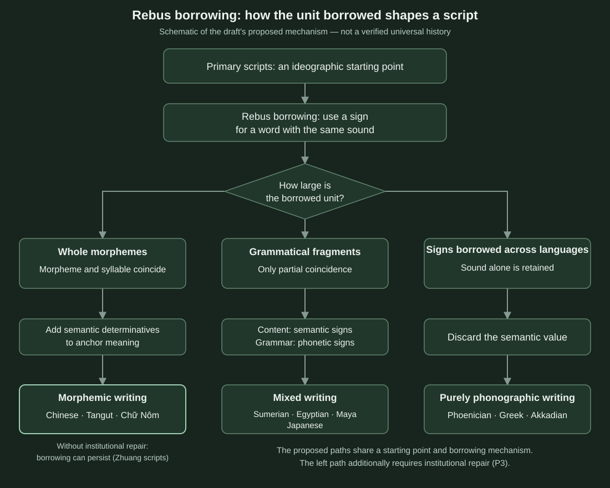

**Theoretical draft · hypotheses to be tested**

## Abstract

**Central claim: writing systems are phenotypes generated by a common mechanism under different parameters.** Written signs are pulled toward the speech unit they most often record. Which unit that is depends on where a language places meaning in the sound stream. A sign recording a meaningful whole binds to meaning; one recording a smaller sound fragment becomes a semantically empty phonographic sign.

**Why Chinese characters bind to meaning:** Chinese meaningful units roughly coincide with syllables and have few attached grammatical elements; speakers invented writing from semasiographic signs; use continued for over three millennia without externally imposed termination. The initial match was approximate and contingent. Once writing bound to meaning, however, it marginalized unwritable small affixes, tightening the match through positive feedback.

**Two tempting mistakes:**

- Pictorial shape is not the cause. Independently invented scripts all begin with meaning-bearing signs. Egyptian remained pictorial for millennia while heavily phonographic; Chinese lost pictorial resemblance but retained semantic function. Pictoriality is neither necessary nor sufficient.
- “Monosyllabic” is insufficient. Sumerian and Mayan roots were also often monosyllabic, but attached grammatical affixes prompted a phonographic layer. The parameter is whether meaningful units are independent syllable-sized wholes.

**Evidence structure:** China is the only independently invented script for an isolating language. Neighboring adaptations of Chinese writing supply natural comparisons: languages with matching boundaries retained morphographic systems; agglutinative languages developed phonography (section 4). This extends comparison beyond one case. Handel (2019) systematically covers the material; this article proposes a common-parameter explanation (sections 8–9).

**The methodological aim:** replace another classification table with a generator and parameters from which classes, exceptions and trajectories can be rederived, then test through comparisons changing one parameter. Section 8 demonstrates this with Handel’s borrowing classification. Writing origins are one application of the approach.

This companion to [Concept Packaging and the Constraints of Characters](./concept-packaging-and-characters.md) addresses the missing link: how the binding begins.

## 1. The generator: one rule, three parameters

**Rule: a written sign ultimately binds to the unit it is most often used to record.** If it records a meaningful whole—a morpheme—it binds to meaning. If it records smaller sound material, such as consonants, syllable fragments or endings, it becomes phonographic.

Independent inventions share a starting sequence: signs for objects, names and numbers, followed by rebus borrowing to write homophones. Rebus use opens phonography. The branch point is the size of the borrowed unit.

**P1: Do morpheme and syllable boundaries coincide?** This is more precise than “monosyllabic” or “isolating.”

- **Coinciding**—Chinese, Tangut, Vietnamese, Zhuang: each morpheme is a complete syllable without internal alternation. Rebus borrowing takes a whole syllable, still morpheme-sized, so a semantic component can pull the sign back to meaning.
- **Noncoinciding:** grammatical material is smaller than a syllable or embedded in a root. Egyptian meaning is carried by consonantal roots with grammatically varying vowels. Japanese 書く / 書かない (*kak-u / kak-anai*, “write / not write”) divides root and ending inside syllables. Recording those elements requires sound-fragment signs.

Tangut shows that the distinction is coincidence rather than isolation: verbs have complex morphology, but CV syllables and whole-syllable affixes occupy separate characters, retaining a morphographic inventory of nearly six thousand signs.

**P2: Where does the script come from?** Was it invented locally from semasiographic signs or borrowed? Was the borrowed system still semantic or already phonographic? A subrule is: **borrowers retain bindings useful to their own language.** Semitic borrowers took sound from Egyptian pictures; Japanese semantic borrowing retained a character’s meaning while changing its sound—kun reading 山 as *yama*, “mountain.”

**P3: Continuity and institutional depth.** Does use continue in the same community? Do standardization and education support repairs such as adding semantic components? Do conquest or religious changes interrupt it?

The parameters combine into three stable forms:

1. **Morphography:** P1 coincidence, semantic origins and institutional repair.
2. **Mixed semantic–phonographic writing:** partial noncoincidence; lexical roots retain semantic signs, grammar and connections use phonography.
3. **Pure phonography:** borrowing by a noncoinciding language, or borrowing a script already phonographic.

All three branches share the starting point and rebus mechanism; borrowed-unit size differs. The left branch also requires institutional semantic repair, P3.

## 2. Parameter table: fourteen writing systems

**In the known cases, the three parameter settings yield the eventual form.** “Coinciding” means broadly matching morpheme and syllable boundaries; “noncoinciding” covers subsyllabic grammar, root-internal material or root–ending boundaries inside syllables.

| Writing system | Language | P1: morpheme–syllable boundaries | P2: origin | P3: continuity | Outcome |
| --- | --- | --- | --- | --- | --- |
| Chinese, Shang to present | Chinese | Coinciding, with some small Old Chinese affixes later lost | Independent, semantic start | Over three millennia uninterrupted | Morphographic; rebus signs increasingly replaced by phonosemantic compounds |
| Sumerian cuneiform | Agglutinative Sumerian | Partly noncoinciding | Independent, semantic start | Retained as a learned language after spoken extinction | Mixed: root logograms, grammatical syllabograms |
| Egyptian hieroglyphs | Consonantal-root Egyptian | Noncoinciding | Independent, semantic start | About 3,500 years, ending through Hellenization and Christianization | Mixed: logograms and determinatives plus 26 uniconsonantal signs |
| Maya writing | Mayan with inflectional affixes | Partly noncoinciding | Independent, semantic start | Interrupted by Spanish conquest | Mixed, with syllabograms for grammar |
| Akkadian cuneiform | Semitic root-and-vowel Akkadian | Noncoinciding | Borrowed from mainly semantic Sumerian | Long | Mainly syllabic with some Sumerian logograms |
| Proto-Sinaitic → Phoenician | Northwest Semitic | Noncoinciding | Egyptian pictures borrowed acrophonically | Long | Consonantal alphabet |
| Greek alphabet | Greek, with vowel-bearing inflection | Noncoinciding | Phoenician, already phonographic | Long | Full alphabet adding vowels |
| Japanese writing | Agglutinative Japanese | Noncoinciding; roots and endings divide within syllables | Chinese | Long | Kanji for meaning, including kun readings; kana for endings and loans |
| Korean writing | Agglutinative Korean | Noncoinciding | Chinese, then independent invention | Long | Idu/hyangchal sound borrowing, then Hunminjeongeum in 1443 |
| Khitan large → small script | Para-Mongolic, polysyllabic agglutinative Khitan | Noncoinciding | Chinese-modeled large script in 920, then small script several years later | Under 300 years; banned in 1191 | Small script mainly combines phonographic elements |
| Tangut | Complex morphology but whole-syllable affixes | Coinciding | Chinese-modeled, 1036 | Declined after Western Xia’s fall | Morphographic, about 5,863 signs |
| Chữ Nôm, Vietnam | Isolating Vietnamese | Coinciding | Chinese borrowing and new signs | Alongside literary Chinese, limited standardization; replaced by Latin writing in the twentieth century | Morphographic, new signs most commonly phonosemantic |
| Zhuang square script, Sawndip | Isolating Zhuang | Coinciding | Chinese borrowing and new signs | Informal folk use, never standardized | One sign per morpheme, mainly rebus signs, few phonosemantic compounds |
| Yi script | Monosyllabic-morpheme Yi | Coinciding | Indigenous tradition | Many variants; standardized as syllabic in 1980 | Traditional mixed system; standardized 756 syllabograms |

No listed P1-noncoinciding language ends in pure morphography; no coinciding language independently develops an alphabet through its own evolution. Vietnamese alphabetization and Yi syllabic standardization are external policy decisions under P3.

## 3. Independent scripts: one starting point, different branches

**The four generally recognized independent inventions share the starting point and differ in rebus-unit size.** Sumer, Egypt, Shang China and Maya used semantic signs for objects, names and numbers, then rebus borrowing. Sumerian borrowed “mouth” (*ka*) for syllable *ka*; Egyptian “mouth” (*r*) for consonant r; Maya a “fin” sign for *ka*; Shang borrowed 来, originally wheat, for “come.” The mechanism is shared; unit size differs.

**Sumerian and Maya: phonography concentrates in grammar.** Both attach grammar around roots. Descriptions are similar: syllabograms write grammar lacking dedicated logograms and foreign names; lexical roots retain logograms. This is the companion article’s division: **meaningful signs represent concepts, phonographic signs connect them.** Systems separated by over two millennia and no contact independently reached this division.

**Egypt: an alphabet was already inside the system.** Consonantal roots carry meaning, grammatical vowels vary and are unwritten. Rebus borrowing therefore targeted consonants. By about 2600 BCE there were 26 uniconsonantal signs, about 100 biconsonantal and 50 triconsonantal signs. Egyptians retained logograms and developed unpronounced semantic determinatives. Like Chinese semantic components, these pull meaning back beside phonography. Egyptian also maintained form–meaning binding, alongside a consonantal channel.

**Shang China: the borrowed unit was a whole morpheme.** Whole-syllable borrowing remained morpheme-sized and produced no sound-fragment signs. Oracle-bone writing has many rebus uses and a minority of phonosemantic compounds, commonly estimated below roughly 30%; by *Shuowen Jiezi*, the latter exceed 80%. The proposed mechanism is phonographic opening through rebus borrowing, followed by semantic repair.

**The other three ended through external events.** Maya continued until Spanish conquest and extensive destruction of texts. Egyptian vanished through Hellenization and Christianization; the latest known hieroglyphic inscription dates to 394 CE. Cuneiform declined under Aramaic alphabetic and Hellenistic pressures. Chinese survival therefore involves both P1 and P3, not internal script structure alone.

**Undeciphered scripts**, including Indus and Proto-Elamite, have unknown parameters and cannot yet test the account.

## 4. Derived scripts: natural comparisons

**Borrowing the same script into different language types produces differentiation by P1.** This is the strongest evidence proposed here, systematically covered by Handel (2019), discussed in section 9: the Chinese starting system is shared, while language and outcome differ.

**Chinese borrowing with coinciding boundaries retains morphography.**

- Tangut (1036): roughly 5,863 nonpictorial signs, still morphographic. Matching, not pictoriality, is the proposed cause.
- Chữ Nôm: monosyllabic Vietnamese words take individual signs; new characters most commonly combine sound and meaning. Borrowers repeat rebus borrowing followed by semantic repair.
- Sawndip: one sign per morpheme, but in a 3,231-sign survey roughly 71% are rebus signs and only 1.2% phonosemantic compounds. Informal use lacked standardization and education. **P1 determines unit size; P3 affects semantic repair.**

**Chinese borrowing with noncoinciding boundaries develops phonography.**

- Japanese: phonographic man’yōgana develops into hiragana and katakana for endings and loans. Kun reading retains meaning but replaces Chinese sound: 山 becomes *yama*. Form–meaning binding can survive complete sound replacement.
- Korean: phonographic idu/hyangchal precedes independent Hunminjeongeum in 1443.
- Khitan: the Chinese-modeled large script appeared in 920, followed only four or five years later by a small script of phonographic elements assembled into blocks, with syllabic affix writing. Historical accounts mention Uyghur influence, not a linguistic cause. This article infers that polysyllabic agglutinative Khitan did not fit one-character–one-syllable large writing. The rapid replacement is interpreted as a particularly quick manifestation.

**Borrowing Egyptian pictures: the alphabet.** Between the nineteenth and sixteenth centuries BCE, Semitic-speaking workers in Sinai assigned the first sound of their own word to Egyptian pictures: “house,” *baytu*, yielded b; “ox head,” *ʾalp*, yielded ʾ. Consonantal-root Semitic needed consonants, yielding the Phoenician ancestor. Greek borrowers added vowels important to inflection and readability. Each adaptation reached units needed by its language.

**Borrowing cuneiform: the same direction.** Root-and-vowel Akkadian used Sumerian signs mainly syllabically while retaining some Sumerian logograms.

**Yi: coinciding languages admit another stable form.** Yi has CV syllables and about 1,164 tonal syllables. Standardization in 1980 adopted 756 basic syllabic signs. For a coinciding language, morphography versus syllabic writing differs in whether homophonous morphemes are distinguished visually. P3 determines the choice; Yi standardization was policy, not spontaneous evolution.

## 5. Chinese: a contingent starting point and feedback amplification

**The starting point was contingent; the proposed amplification was not.** A language with roughly coinciding boundaries happened to coexist with local invention. Vietnamese, Thai and Hmong–Mien share the type but did not independently invent writing. Once the conditions coincide, the account attributes subsequent direction to feedback.

### 5.1 The initial match was approximate

Baxter and Sagart reconstruct Old Chinese with presyllables, consonant clusters and subsyllabic affixes such as s- and -s. P1 was only approximate. More numerous, productive small affixes might have generated a sound-fragment layer like Egyptian.

### 5.2 Feedback tightens the match

The following chain is a hypothesis. Hannas advanced a stronger claim that writing shaped Chinese monosyllabic morphology; Handel considers the evidence insufficient (section 9). This version says writing accelerated and locked in an ongoing process.

1. Syllable-sized characters cannot separately display smaller affixes.
2. Invisible derivation becomes different readings of one character or apparently unrelated characters; affixes lose productivity.
3. Affixes erode, some becoming tones; one-syllable–one-meaning matching tightens.
4. Better matching favors character use and semantic additions to rebus signs; phonosemantic compounds grow from a minority in oracle bones to a majority in *Shuowen*.
5. Meaning-based circulation lets mutually unintelligible varieties share writing. Qin script unification institutionalizes this and deepens P3.
6. Institutional depth raises switching costs and strengthens binding.

This is generative lock-in: an approximate early condition becomes entrenched until it appears inherent. The companion article’s section 3 covers later lock-in; this section supplies antecedent conditions.

### 5.3 Before oracle bones: archaeological evidence

Current material supports “oracle-bone writing was not the beginning.” A *People’s Daily Overseas Edition* review of 2025-12-15 summarizes:

| Site | Date | Finding |
| --- | --- | --- |
| Taosi, Xiangfen, Shanxi | Longshan period, about 4,100 years ago | Vermilion writing on a flat pottery flask, interpreted as 文邑 / 文尧 (*wen yi / wen yao*); forms beyond simple depiction, with methods resembling Shang vermilion writing |
| Zhengzhou Shang city | Early Shang | Vermilion pottery-jar writing, one sign identified as 天 (“heaven”) |
| Xiaoshuangqiao, Zhengzhou | Early Shang | Vermilion ritual-vessel signs grouped as numerals, pictures/clan emblems and ritual wording |
| Erligang, Zhengzhou | Early Shang | Ox-rib inscription excavated in 1953: 11 signs in three lines, described as the earliest known incised inscription |
| Yinxu, Anyang | Late Shang | Vermilion/ink writing on jade; some bones written before carving |

The review concludes that writing was mature by early Shang at the latest, likely mainly on perishable bamboo and wooden slips. Whether earlier Neolithic marks at Jiahu, Dawenkou and elsewhere count as writing remains disputed.

**Implications here:**

- The earliest identified Chinese writing at Taosi is interpreted as one sign per word.
- Rebus/semantic balance likely predates oracle bones, with much evidence lost on perishable slips.
- **A prediction open to discoveries:** pre-oracle Chinese material should contain semantic signs and whole-syllable rebus uses, not consonant-only or syllable-fragment signs. Discovery of such a layer would indicate written small affixes and require revising section 5.2’s sequence.

## 6. Proposed regularities and testable predictions

**Sections 2–5 suggest five regularities and five predictions.**

**Regularities:**

1. **Pictoriality is neither necessary nor sufficient.** Egyptian is pictorial yet phonographic; Tangut is nonpictorial yet morphographic.
2. **Phonography concentrates in connections.** Sumerian/Maya syllabograms mark grammar, kana endings, Cantonese mouth-radical signs connections; conceptual material retains semantic writing.
3. **Borrowers retain useful bindings.** Semitic borrowers take Egyptian sounds; Japanese kun reading takes Chinese meanings.
4. **Semantic repair needs institutions.** Chữ Nôm’s literati tradition favors phonosemantic creation; informal Sawndip has only 1.2%.
5. **No known naturally evolved alphabet comes from a boundary-coinciding language.** Alphabets emerge in noncoinciding languages or arrive through policy.

**Testable predictions:**

1. In mixed-script corpora, phonographic signs should be significantly more frequent in grammatical/connective elements than lexical roots. Count separately in Sumerian, Egyptian, Maya, Japanese and written Cantonese.
2. Pre-oracle Chinese should contain semantic and whole-syllable rebus signs, not consonant or syllable-fragment signs.
3. Periodized Chữ Nôm corpora should show increasing phonosemantic proportions, repeating the Chinese trajectory.
4. Among Chinese-script borrowers, greater boundary noncoincidence should predict earlier and more extensive phonography.
5. A coinciding language inventing writing with institutional support should yield morphography or a large syllabary rather than a phonemic alphabet.

## 7. Boundaries, counterexamples and open problems

**The generator is currently a condition-based account supported by comparisons, not a statistically tested law.** Five weaknesses remain:

- **Few independent cases:** four recognized independent inventions, only Chinese with coinciding boundaries.
- **Confounded derived cases:** Tangut, Vietnamese and Zhuang may imitate Chinese prestige. Japanese and Khitan also imitate Chinese but become phonographic, showing prestige is insufficient; Uyghur influence on Khitan nevertheless prevents isolating P1.
- **Reconstructed language types:** Old Chinese affixes and Sumerian/Khitan morphology remain uncertain. Khitan historical records mention Uyghur influence; failure to fit agglutination is this article’s inference.
- **Inconsistent counting:** phonosemantic percentages differ by counting method. The directional “minority → over 80%” is used pending original-statistic checks.
- **P3 is not derived from P1:** conquest, religion and colonial policy are external. Vietnamese alphabetization, Yi standardization and Egyptian/Maya termination depend on them.

**Open question:** why did Vietnamese, Thai and Hmong–Mien not independently invent writing? Conditions such as state scale, ritual and recording needs may matter, not language type alone. The generator explains form after emergence, not why writing appears.

## 8. Can the generator derive existing classifications? A comparison with Handel

**Handel’s borrowing classes can be rederived, with proposed predictions about relative frequency by language type.** Classification identifies forms; a generator explains their parameter conditions.

### 8.1 Handel’s classification is two-dimensional

Following Boltz, Handel writes a sign as G(P,S): graphic form G with pronunciation P and meaning S—the companion article’s (s,g,m) triple already exists in prior work. Reviews confirm four classes; others await the book:

- **DAL:** directly adopted logograms, borrowing sign and word together as Sino-Xenic vocabulary.
- **SAL:** semantically adopted logograms, retaining meaning but reading the native word, such as 山 *yama*.
- **PAP:** phonetically adopted phonograms, retaining sound only, as man’yōgana.
- **SAP:** semantically adopted phonograms, first assigning a native semantic reading, then using that word’s sound elsewhere.

Two dimensions are involved: **which binding is retained**—P or S—and **which unit is recorded after borrowing**—a whole morpheme/logogram or sound fragment/phonogram.

### 8.2 What determines the two dimensions?

- **P1 determines unit size.** Coinciding native boundaries let phonetic borrowing record a whole morpheme; noncoincidence yields sound fragments.
- **Useful binding and native-word length determine what is retained.** A monosyllabic word can often match a Chinese pronunciation. A polysyllable such as *yama* cannot fit one Chinese sound; writing it with one sign requires semantic borrowing.

### 8.3 Class-by-class comparison

| Handel class | Generator interpretation | Prediction | Known observation | Status |
| --- | --- | --- | --- | --- |
| DAL | Borrow a morpheme with localized pronunciation | Independent of P1; quantity depends on contact | Large Sino-Xenic vocabulary in Japanese, Korean and Vietnamese | Consistent |
| SAL | Retain meaning, discard sound; one sign per native morpheme | More with polysyllabic native morphemes, less with monosyllabic ones | Many Japanese kun readings; rare in isolating Vietnamese according to Handel | Consistent |
| PAP | Retain sound, discard meaning; record fragments | More with noncoincidence, concentrated in endings/function words | Man’yōgana, idu/hyangchal and Khitan small-script affixes | Consistent; concentration requires counts |
| SAP | Native semantic reading then reused for sound | Only where SAL develops; nearly absent in Vietnamese/Zhuang | Japanese kun-gana | Japanese consistent; others await checking |
| Phonetic borrowing of a whole native morpheme | Sound retained, semantic discarded, unit still a morpheme | Dominant in coinciding languages | About 71% rebus Sawndip; extensive homophonic Chinese borrowing in Nôm | A generator-derived cell; whether Handel already includes it awaits checking |
| New signs, including phonosemantic compounds | Repair bringing meaning back into form | Requires institutions, P3 | Common in Nôm; 1.2% in Sawndip | Consistent |
| Independent phonographic layer | PAP stabilizes and forms simplify | Noncoincidence with sustained use | Kana, Khitan small script; Korean’s separately invented Hangul | Consistent |

**Conclusion:** the account treats each cell as a phenotype under different parameters. Handel’s finding that Vietnamese rarely uses SAL becomes a proposed implication. Two further predictions are nearly absent Vietnamese/Zhuang SAP and connective concentration of PAP across languages.

**Limitation:** this section relies on reviews, not complete verification of Handel’s book. Full classes and counts await reading. If the book already links frequencies to typology, the contribution narrows to a common-parameter explanation.

## 9. What earlier work already established

**The central claim that linguistic structure kept Chinese writing from becoming alphabetic is not new.** The proposed addition compresses parallel causes into a parameter, rederives classes and proposes predictions beyond classification.

| Prior work | What it established or proposed | What it did not cover | Implication here |
| --- | --- | --- | --- |
| Boltz (1994; “Why no A-B-C?” lecture) | G(P,S); common Egyptian/Chinese start and later divergence; semantic retention prevents alphabetization; linguistic, contact, cultural and recording factors | Not reduced to one parameter or tested through derived scripts | Starting point and triple are inherited |
| Handel (2019), *Sinography* | Borrowing driven/constrained by recipient typology; DAL/SAL/PAP/SAP; agglutinative use of both kinds, rare Vietnamese semantic borrowing; Korean, Vietnamese, Japanese, Zhuang, Khitan and Jurchen with Sumerian/Akkadian comparisons | Reviews use isolating/agglutinative distinction, not boundary coincidence; frequency derivation awaits book | Section 4’s material and direction are inherited; addition narrows to section 8 |
| Hannas (1997, 2003) | Writing shaped Chinese monosyllabic morphology, according to Handel’s review | Handel rejects the strong claim as insufficiently evidenced | Section 5.2 must remain a mechanism hypothesis with tests |
| Tranter (2013), *Written Language and Literacy* | Functional comparisons of over a dozen logographic systems; phonetic complements mark Akkadian case endings and Japanese okurigana; morphology complicates statistics | No cross-system law of connective concentration | Proposed regularity 2 generalizes observations; his coding can test prediction 1; morphology becomes P1 to measure |
| Computational writing-invention model, *Written Language and Literacy* | Simulations favor invention with monosyllabic morphemes or rich vowel alternation | Emergence, not subsequent form | Complementary, potentially relevant to section 7 |
| Gelb (1952) | Unidirectional evolution from semantic through syllabic to alphabetic | Widely criticized | Rejecting one-way evolution is not new |

**Revisions following this comparison:**

1. Credit Boltz for “why Chinese did not become alphabetic”; it is not a new conclusion.
2. Credit Handel for derived-script evidence and typological influence; the proposed addition is parameter unification and frequency predictions.
3. Section 5.2 is a disputed Hannas-related hypothesis, not established fact. Compare whether Vietnamese/Thai retain more derivational traces despite similar affix loss.
4. “Phonography concentrates in connections” generalizes earlier observations and remains a hypothesis before counts.

**Candidate additions remaining after revision:** boundary coincidence, distinguished from isolation by Tangut; generator-based derivation of classes and frequencies; connective division across independent and derived writing; the pre-oracle absence-of-fragment prediction; and the chain from writing origins to production costs and learning.

## References

- [*People’s Daily Overseas Edition* (2025-12-15): Looking Back beyond Oracle-Bone Writing](https://paper.people.com.cn/rmrbhwb/pc/content/202512/15/content_30120543.html)
- [Christian Lehmann: Hieroglyphic writing](https://www.christianlehmann.eu/ling/sprachen/languages_antiquity/egypt/hieroglyphs.html)
- [Proto-Sinaitic script, Wikipedia](https://en.wikipedia.org/wiki/Proto-Sinaitic_script)
- [Maya script, Wikipedia](https://en.wikipedia.org/wiki/Maya_script)
- [Overview of Sumerian Language and Culture, PSD](https://psd.alephnull.net/sumerian.html)
- [Tangut script](https://en.wikipedia.org/wiki/Tangut_script); [Tangut language](https://en.wikipedia.org/wiki/Tangut_language), Wikipedia
- [BabelStone: The mystery of the two Khitan scripts](https://babelstone.co.uk/Blog/2010/12/mystery-of-two-khitan-scripts.html); [Khitan small script, Wikipedia](https://en.wikipedia.org/wiki/Khitan_small_script)
- [Chữ Nôm, Wikipedia](https://en.wikipedia.org/wiki/Ch%E1%BB%AF_N%C3%B4m)
- [Sawndip, Wikipedia, including Holm’s 3,231-sign counts](https://en.wikipedia.org/wiki/Sawndip)
- [Yi script, Wikipedia](https://en.wikipedia.org/wiki/Yi_script)
- Baxter & Sagart (2014), *Old Chinese: A New Reconstruction*, Oxford University Press
- Gelb (1952), *A Study of Writing*: proposes one-way semantic–syllabic–alphabetic evolution; this article instead makes outcomes parameter-dependent.
- Companion: [Concept Packaging and the Constraints of Characters](./concept-packaging-and-characters.md)

Prior work in sections 8–9:

- Boltz (1994), [The Origin and Early Development of the Chinese Writing System](https://asian.washington.edu/research/publications/origin-and-early-development-chinese-writing-system); [lecture abstract: Why no A-B-C?](https://www.aai.uni-hamburg.de/china/aktuelles/vortrag-boltz.html)
- Handel (2019), [Sinography: The Borrowing and Adaptation of the Chinese Script](https://asian.washington.edu/research/publications/sinography-borrowing-and-adaptation-chinese-script); [Li’s review](https://ira.lib.polyu.edu.hk/bitstream/10397/92297/1/DCS_Li_2019_review_Zev_Handel_Sinography_China_and_Asia_accepted.pdf)
- Hannas (1997), [Asia’s Orthographic Dilemma](https://www.ubcpress.ca/asias-orthographic-dilemma); Hannas (2003), *The Writing on the Wall*
- Tranter (2013), [Logography and layering: A functional cross-linguistic analysis](<https://eprints.whiterose.ac.uk/id/eprint/91110/7/NT%20(2013)%20Logography%20(WL&L)%20-%20AAM.pdf>), *Written Language and Literacy* 16(1)
- [A computational model of the discovery of writing](https://www.benjamins.com/catalog/wll.00004.spr), *Written Language and Literacy*

---

## Research and version notes

> **Theoretical draft v0.1** · This article contains hypotheses and proposed implications awaiting testing. Evidential limitations, counterexamples and references awaiting verification are retained.
