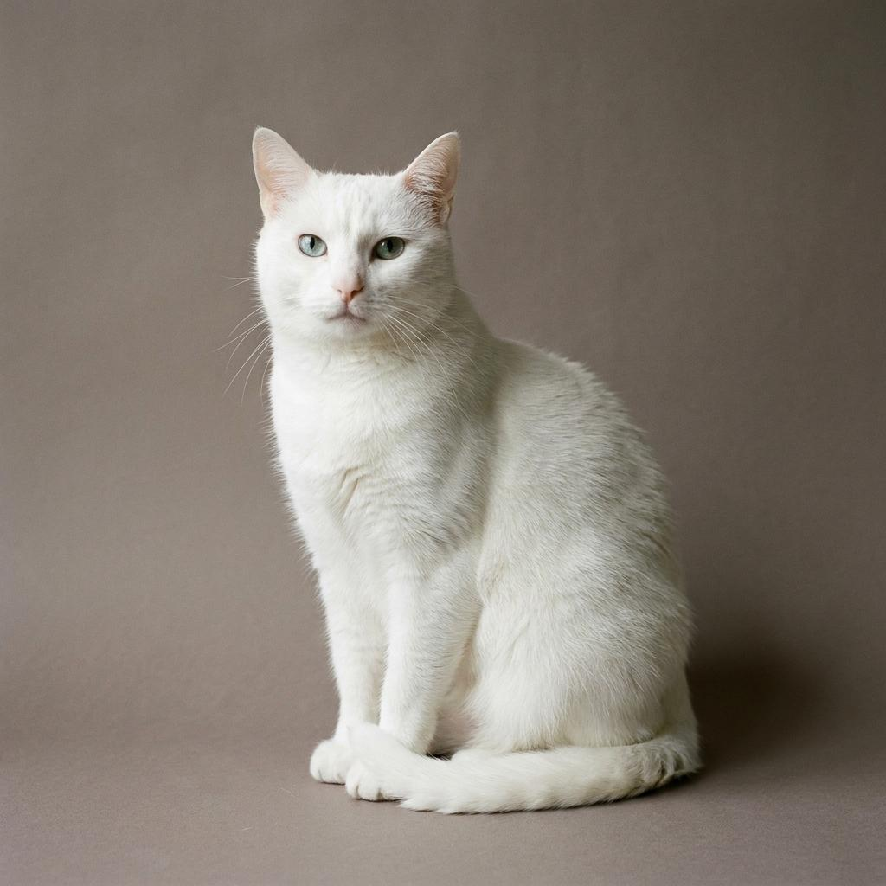
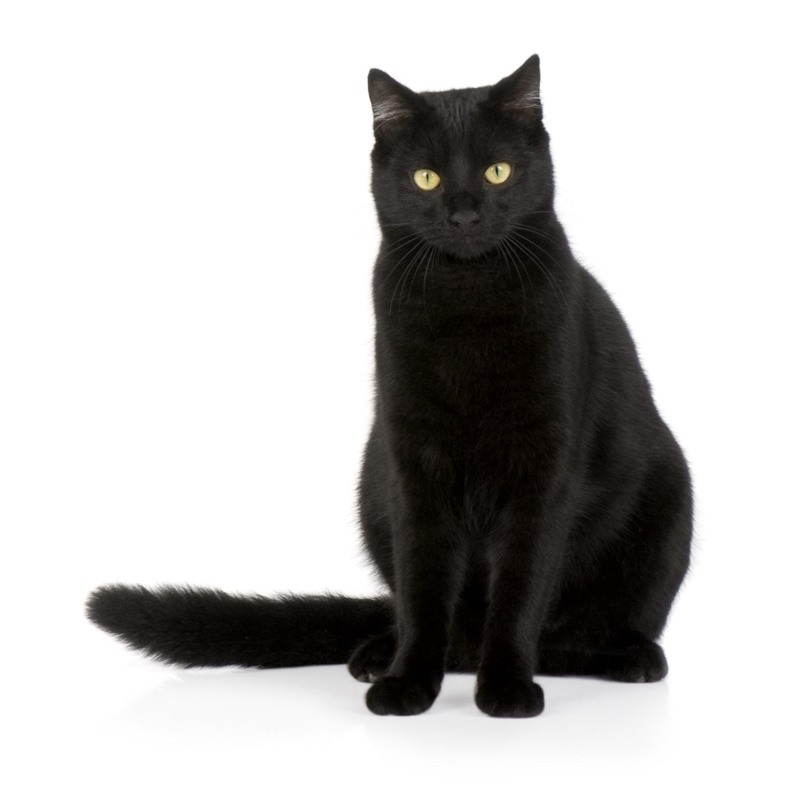
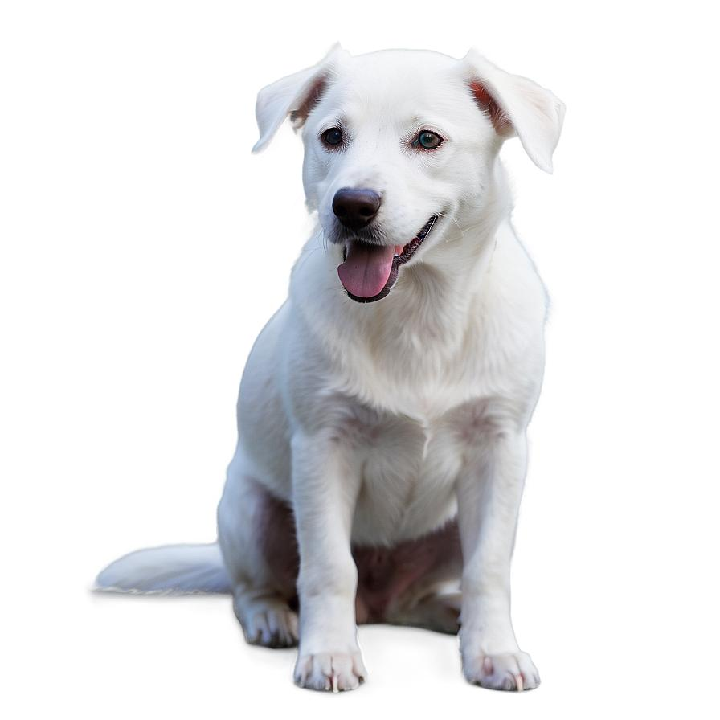

**Introduction to Large Language Models · Learner’s Edition v0.1**

Previous lesson: [How Can We Use Numbers to Represent Information?](./lesson-01-representation.md)

Get a piece of paper and a pen. You only need to know how to compare numbers, add, and multiply. You don’t need to know anything about AI. Try your own way first, and open a hint if you need one.

## 1. Which animal is more like the white cat?

Look again at the three photographs from the last lesson: a white cat, a black cat, and a white dog.

<div class="course-exercise">
<div class="course-photo-gallery">
<figure>
  
  <figcaption>White cat</figcaption>
</figure>
<figure>
  
  <figcaption>Black cat</figcaption>
</figure>
<figure>
  
  <figcaption>White dog</figcaption>
</figure>
</div>
</div>

Now imagine a fourth photograph, this time of a black dog. You’ll use all four animals in the scoring exercise.

Which do you think is more like the white cat, the black cat or the white dog? Why?

Write down your reason first. It’s fine if you think they are equally similar.

<details class="course-reveal">
<summary>After thinking it through, see some possible answers</summary>

Some people choose the black cat because it’s a cat too. Others choose the white dog because it’s white too.

Some people think they are equally similar. Each has one thing in common with the white cat.

The answers can differ because people are comparing different things.

</details>

Now let’s agree on a rule for this game. **Give one point for matching colour and one point for matching animal type.** If both match, give two points. If neither matches, give zero.

Before looking at the number cards, can you work out the scores for the black cat, the white dog, and the black dog? Write your answers down so you can use them to check your method later.

## 2. Let the numbers help us score

Last time, we made number cards like these. In the left box, 0 means white and 1 means black. In the right box, 0 means cat and 1 means dog.

| Photograph | Left box | Right box |
|---|:---:|:---:|
| White cat | 0 | 0 |
| Black cat | 1 | 0 |
| White dog | 0 | 1 |
| Black dog | 1 | 1 |

Design a way to follow the scoring rule using only the numbers on two cards.

If you made different cards in the last lesson, try using your own first. See whether your method works for all four animals.

<details class="course-reveal">
<summary>Get a small hint</summary>

The first box is the same for the white cat and the white dog. What about the second box? What could you do each time you find a match?

</details>

<details class="course-reveal">
<summary>After trying it, see one way to do it</summary>

Compare one box at a time. Give one point for a match and zero for a difference, then add the points.

| Compared with the white cat | Colour points | Animal type points | Total |
|---|:---:|:---:|:---:|
| White cat | 1 | 1 | 2 |
| Black cat | 0 | 1 | 1 |
| White dog | 1 | 0 | 1 |
| Black dog | 0 | 0 | 0 |

Compare the results with what you wrote down in the first section. If they agree, this method does the job. Your own method is just as good if it gives the right scores too.

</details>

## 3. Is there another way to calculate it?

The method we just used already works. Let’s explore another way and see whether each feature the animals share can contribute a point directly.

This time, give the card four boxes, one each for white, black, cat, and dog. Write 1 if the animal has that feature and 0 if it doesn’t.

| Photograph | White | Black | Cat | Dog |
|---|:---:|:---:|:---:|:---:|
| White cat | 1 | 0 | 1 | 0 |
| Black cat | 0 | 1 | 1 | 0 |
| White dog | 1 | 0 | 0 | 1 |
| Black dog | 0 | 1 | 0 | 1 |

How could you count the features shared by two cards using only multiplication and addition?

<details class="course-reveal">
<summary>Get a small hint</summary>

Try calculating 1×1, 1×0, 0×1, and 0×0. Which one gives 1?

</details>

<details class="course-reveal">
<summary>See one way to calculate it</summary>

You get 1 only when both boxes contain 1. Multiply the numbers in matching positions and then add the results.

For example, compare the white cat and the black cat.

```text
White cat      1    0    1    0
Black cat      0    1    1    0
Multiply       0    0    1    0
```

The score is 0 + 0 + 1 + 0 = 1. The feature they share is “cat”.

</details>

Without looking at the answers, try the white cat with the white dog, and the white cat with the black dog. Do the results agree with the first section? Then choose any two cards, predict their score, and calculate it to check.

We used a different representation and a different calculation to do the same scoring task. The first method still works.

## 4. Now you decide what to compare

The game treated colour and animal type as equally important. Now you get to decide what to compare.

Try writing down your answers to these questions.

- What do I want to compare?
- Which two cards do I want to score higher, and why?
- Do my current cards and calculation still work? How can I check?

Keep your method if it still does the job. If it falls short, try changing the cards or the scoring rule.

<details class="course-reveal">
<summary>After trying your own idea, see one example</summary>

Suppose I only want to compare colour. I shouldn’t give an extra point just because both animals are cats.

I can compare only the colour boxes. Then I can try the white cat with the black cat, and the white cat with the white dog, to see whether the results fit my new rule.

</details>

<section class="course-exercise course-score-lab" data-course-score data-course-control hidden>
<strong>Change the rule and check the scores</strong>
<p>Compare each animal with the white cat. Predict which will score highest, then choose a rule. Each match earns one point. All bars use the same scale from 0 to 2.</p>
<fieldset class="course-score-options">
<legend>Choose a comparison rule</legend>
<label><input type="radio" name="comparison-standard" value="colour">Colour only</label>
<label><input type="radio" name="comparison-standard" value="type">Animal type only</label>
<label><input type="radio" name="comparison-standard" value="both">Both</label>
</fieldset>
<ul class="course-score-results" data-score-results hidden aria-live="polite">
<li data-colour-match="0" data-type-match="1"><span>Black cat</span><meter min="0" max="2" value="0" aria-label="Black cat score"></meter><strong data-score-value>0</strong></li>
<li data-colour-match="1" data-type-match="0"><span>White dog</span><meter min="0" max="2" value="0" aria-label="White dog score"></meter><strong data-score-value>0</strong></li>
<li data-colour-match="0" data-type-match="0"><span>Black dog</span><meter min="0" max="2" value="0" aria-label="Black dog score"></meter><strong data-score-value>0</strong></li>
</ul>
</section>

## 5. Looking back: What did we learn?

Last time, we learned to represent things using numbers. This time, we started using those numbers to calculate relationships between things.

Start by deciding what you want to compare. Then decide what the numbers should mean and how to use them. Finally, check the calculation against answers you already know.

In Section 3, we multiplied the numbers in matching positions, then added the products. In mathematics, this operation is called the **dot product**.

With our four-box cards, the dot product counts the features the two animals have in common. With different cards or a different goal, it may give a different kind of result.

## 6. How real large language models use it

A Transformer also takes the dot product of two groups of numbers to get a score. This is one important operation it uses to calculate how well information from different positions matches.

A real model uses numbers different from our hand-written animal features. It uses the same mathematical operation, but what the score means depends on its representations and the way it has learned to use them.

| Term | Meaning in this lesson |
|---|---|
| Relation | A connection between two objects that we can describe or test. In this lesson, we look at shared features. |
| Similarity | How alike things are according to a chosen standard. We can choose different standards. |
| Dot product | Multiply the numbers in matching positions in two lists of equal length, then add the products. |
| Compatibility score | A number that measures how well two representations match. Transformers use dot products as the basis for calculating such scores. |

A real Transformer does more with those scores. We’ll leave those steps for later.

## 7. Bring your own question to the next lesson

We can now use numbers to represent information and calculate a kind of compatibility score.

What else would you like to do with these cards? Write down a new question and how you would test your idea.

Next time, we’ll explore a question: can we use different numerical representations for the same object when we have different tasks?
